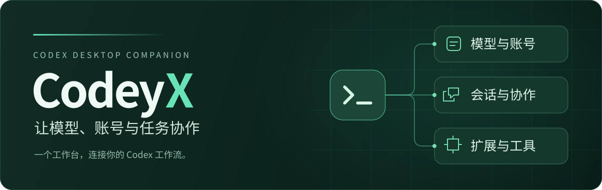
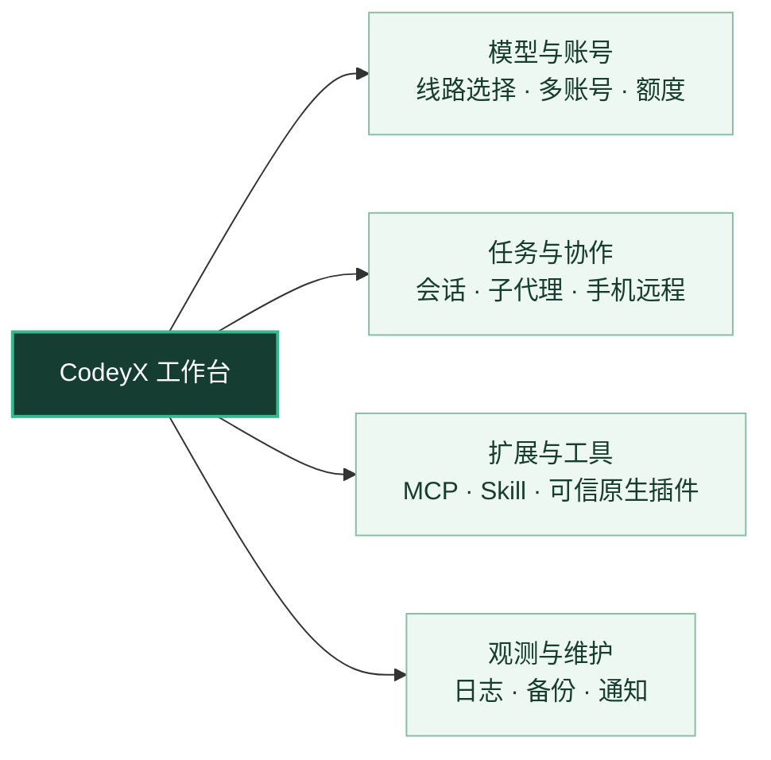
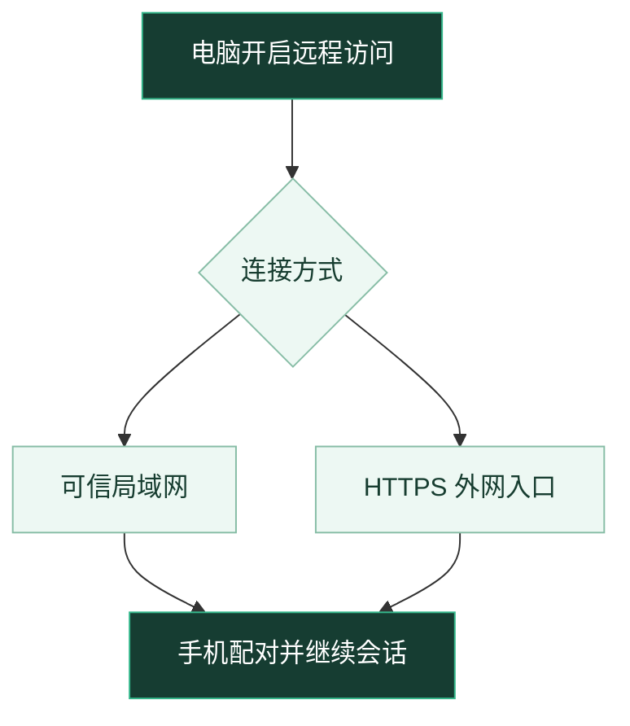
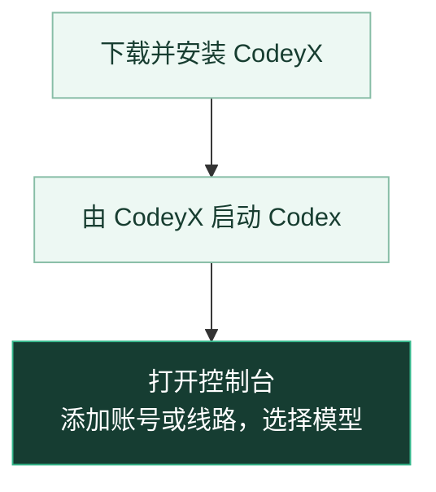

<h1>CodeyX · Codex 桌面增强工作台</h1>

选好模型，组织任务，随时接着做。

  
  
  
  

  <a href="https://github.com/fraternity-z/CodeyX/releases/latest">下载最新版</a>
  · <a href="#功能总览">功能总览</a>
  · <a href="#界面预览">界面预览</a>
  · <a href="#开始使用">开始使用</a>
  · <a href="#主要功能">主要功能</a>
  · <a href="#使用须知">使用须知</a>
  · <a href="https://github.com/fraternity-z/CodeyX/issues">问题反馈</a>

CodeyX 是独立维护的 Codex 桌面增强启动器，将模型、账号、会话和扩展集中在一个控制台中管理，配合已安装的 Codex 桌面客户端使用。

> 当前主要面向 **Windows** 开发、测试与发布，其他平台不在维护范围内。

## 功能总览

| 想做什么 | CodeyX 可以帮你 |
| :--- | :--- |
| **按任务选择模型** | 集中管理官方账号与第三方线路，在任务中选择模型和思考强度。 |
| **让不同角色协作** | 为子代理分配模型、读写能力与分工，按需启用文件检索和扩展工具。 |
| **离开电脑继续工作** | 在手机上查看会话、发送文字或照片，通过通知关注任务进展。 |
| **了解用量并保留配置** | 查看请求表现与账号额度，按需备份配置或管理会话。 |

各项能力按需配置，具体可用范围取决于客户端版本、所选线路和权限。

## 界面预览

### 模型与账号，一处管理

在 Codex 内打开 CodeyX 控制台，查看账号额度、同步线路模型，并选择默认模型。

> 以下截图均使用演示数据，账号与服务地址为示例，模型名称、界面与可用能力以安装版本为准。

### 看清请求，也安排好分工

<table>
  <tr>
    <th width="50%">请求日志</th>
    <th width="50%">子代理配置</th>
  </tr>
  <tr>
    <td></td>
    <td></td>
  </tr>
  <tr>
    <td>按线路、模型和状态筛选请求，定位耗时与错误。</td>
    <td>为不同任务选择角色、读写能力、模型与思考深度。</td>
  </tr>
</table>

点击图片可查看大图；请求日志需手动开启，记录范围限于经过 CodeyX 的请求，不作为完整账单或审计记录。

### 离开电脑，手机接着做

在手机上继续电脑会话，查看任务进展并发送文字或照片，身份验证及未支持的操作仍需在电脑处理。

  

电脑须保持运行，远程访问需手动开启并配对，设备授权可随时撤销；网络与隧道限制见[使用须知](#网络与远程访问)。

## 开始使用

准备好已安装的 Codex 桌面客户端，再按下面的顺序开始：

1. 从 [Releases](https://github.com/fraternity-z/CodeyX/releases/latest) 下载 Windows 安装包，查看对应版本的发布说明。
2. 安装并打开 CodeyX，由 CodeyX 启动已安装的 Codex 桌面客户端。
3. 在 Codex 内打开 CodeyX 控制台，添加官方账号或第三方线路，选择要使用的模型。

首次启动前请先结束正在运行的任务；客户端兼容、凭据保存和远程访问的边界见[使用须知](#使用须知)。

## 主要功能

### 线路与账号

| 能力 | 说明 |
| :--- | :--- |
| **线路与模型** | 管理官方及 Gemini 等第三方线路，支持 New API 连接串快速导入，在任务中切换模型与思考强度。 |
| **多账号管理** | 管理多个 ChatGPT 账号、查看额度，并按需启用官方直连授权。 |
| **远程压缩** | 根据线路能力压缩上下文，支持跨线路继续对话。 |
| **网络代理** | 设置 Codex 启动代理与线路代理，启动代理无法应用时提示并继续启动。 |

### 会话与协作

| 能力 | 说明 |
| :--- | :--- |
| **会话管理** | 查看任务状态、导入导出与恢复备份，支持永久清理本机会话及归档。 |
| **手机远程** | 通过局域网或 HTTPS 隧道在手机上继续电脑会话，支持发送照片。 |
| **提示词优化** | 一键优化输入内容，优化结果可继续编辑。 |
| **对话 Git 提交** | 根据本对话改动生成中文提交说明，可选择仅提交或提交并推送。 |
| **模型分工** | 支持内置与自定义子代理，可配置读写能力、并发数量、模型与思考深度。 |

### 扩展与工具

| 能力 | 说明 |
| :--- | :--- |
| **扩展管理** | 管理 MCP、Skill 和可信原生插件，通过插件扩展线路、密钥轮换与账号接入。 |
| **MCP 共享** | 可选启用共享器，统一管理内置工具及兼容 MCP 的进程，支持并发调度和释放空闲实例；有状态服务保持直连。 |
| **页面增强** | 改善常用会话操作与插件市场体验，支持精选插件离线恢复。 |
| **桌面操作** | 可选安装 CodeyX Computer Use 工具，读取应用状态并执行点击、输入和滚动。 |
| **文件检索** | 使用内置 FastCtx 读取、搜索和发现文件，按需替换明确的文本。 |
| **代码理解** | CodeGraph 仅为工作区已添加的本地项目自动建库并同步，辅助理解代码结构与调用关系。 |
| **开发习惯** | 可选自动安装 Ponytail 插件并配置默认模式。 |

### 备份、观测与维护

| 能力 | 说明 |
| :--- | :--- |
| **配置备份** | 在独立页面导入导出 JSON 配置，支持 WebDAV 云备份与确认恢复。 |
| **请求与用量** | 按需记录经过 CodeyX 的请求耗时、输出速度、Token 用量与错误分布，并在对话状态条查看会话活动和缓存命中率。 |
| **任务通知** | 通过飞书、企业微信、Telegram、ntfy 或微信 ClawBot 接收任务状态通知。 |
| **诊断维护** | 检查和修复配置、恢复断线，并管理诊断日志与启动选项。 |
| **版本更新** | 按需开启稳定版更新检查、阅读完整公告，并在系统设置中选择 GitHub 官方源或 GH-Proxy 下载安装包。 |

## 使用须知

### 客户端与模型兼容

- **客户端兼容**：仅支持可明确识别的 Codex 桌面客户端；启动可能重启客户端，请先结束任务，多版本共存时需明确选择。
- **WSL 模式（实验性）**：支持 Windows 客户端配合 WSL 后端运行，需启用 Windows 程序互操作，兼容性仍在验证中。
- **服务商限制**：上下文预算不能扩大服务商容量，第三方能力及跨线路兼容性取决于服务商和 Codex 版本。
- **更新选择**：“不更新”仅关闭自动检查，仍可手动检查稳定版。

### 数据与凭据

- **会话清理**：永久清理无法撤销，需通过 CodeyX 重启 Codex 完成；不处理项目文件、云端会话或用户另存的导出与备份。
- **账号与线路**：官方线路需添加官方账号，默认账号决定客户端登录身份；既有手填代理凭据、第三方密钥及部分通知凭据以明文保存在本地私有配置和备份中，请妥善保管。
- **配置恢复**：恢复前自动保留当前配置，保留本机账号、插件线路和路径；JSON 含明文密钥，WebDAV 默认使用 HTTPS，会话与扩展文件需单独备份。

### 网络与远程访问

- **网络接入**：启动代理依赖程序遵守代理设置，留空或无法应用时沿用原有网络环境，不保证所有流量经过代理。
- **远程访问**：需手动开启并配对，电脑须保持运行；局域网仅用于可信网络，临时隧道经过 Cloudflare 且地址会变化，设备授权可随时撤销。

### 安装与扩展权限

- **安装安全**：安装包和原生插件仅使用可信来源；原生插件拥有与 CodeyX 相同的系统权限，集成失败后仅在确认清理完成时尝试原生启动。
- **注入修复**：支持手动确认后修复兼容的 Windows 独立客户端并保留回滚备份；修复会使客户端 DLL 原厂签名失效，客户端更新可能覆盖补丁。
- **桌面工具**：需先在 CodeyX 中手动准备，再到 Codex 安装启用。
- **文件工具**：内置 FastCtx 原生工具仅在兼容客户端的本地完全访问会话中启用，使用自定义 FastCtx 时应停用内置工具。

## 文档与反馈

| 入口 | 内容 |
| :--- | :--- |
| [版本发布](https://github.com/fraternity-z/CodeyX/releases) | 安装包、版本变化与升级说明。 |
| [问题反馈](https://github.com/fraternity-z/CodeyX/issues) | 报告使用问题或提出功能建议。 |
| [内部开发文档](INTERNAL_DEVELOPMENT.md) | 面向维护者的核心流程、依赖与兼容边界。 |
| [架构分层规范](ARCHITECTURE.md) | 参与开发时的职责、依赖与状态约束。 |
| [插件 SDK](crates/codey-plugin-sdk/README.md) | 可信原生插件的开发入口与协议契约。 |
| [第三方声明](THIRD_PARTY_NOTICES.md) | 第三方资源的版权、许可与必要声明。 |

反馈问题时请附上 CodeyX 与 Codex 版本、复现步骤和错误现象，避免提交密钥或完整私有配置。

## 来源与许可

CodeyX 基于 [SuperGness/Codey](https://github.com/SuperGness/codey) 独立维护，由 fraternity-z 继续开发，与上游无官方隶属或背书关系；问题请反馈至本仓库。

本项目沿用 [AGPL-3.0-only](LICENSE) 许可，保留上游版权与必要的[第三方声明](THIRD_PARTY_NOTICES.md)。

FastCtx 第三方声明（Apache-2.0）

    This product includes FastCtx
    (https://github.com/yc-duan/fastctx), Copyright (c) 2026 yc-duan,
    used under the Apache License 2.0.

    FastCtx is redistributed and/or modified here by the maintainer of
    this distribution. Any such change is that maintainer's own work
    and their sole responsibility. It is not endorsed by, not
    supported by, and not attributable to the author of FastCtx, who
    accepts no liability of any kind arising from this distribution or
    from anything built on top of it.

